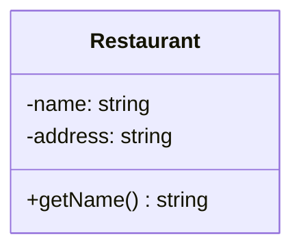
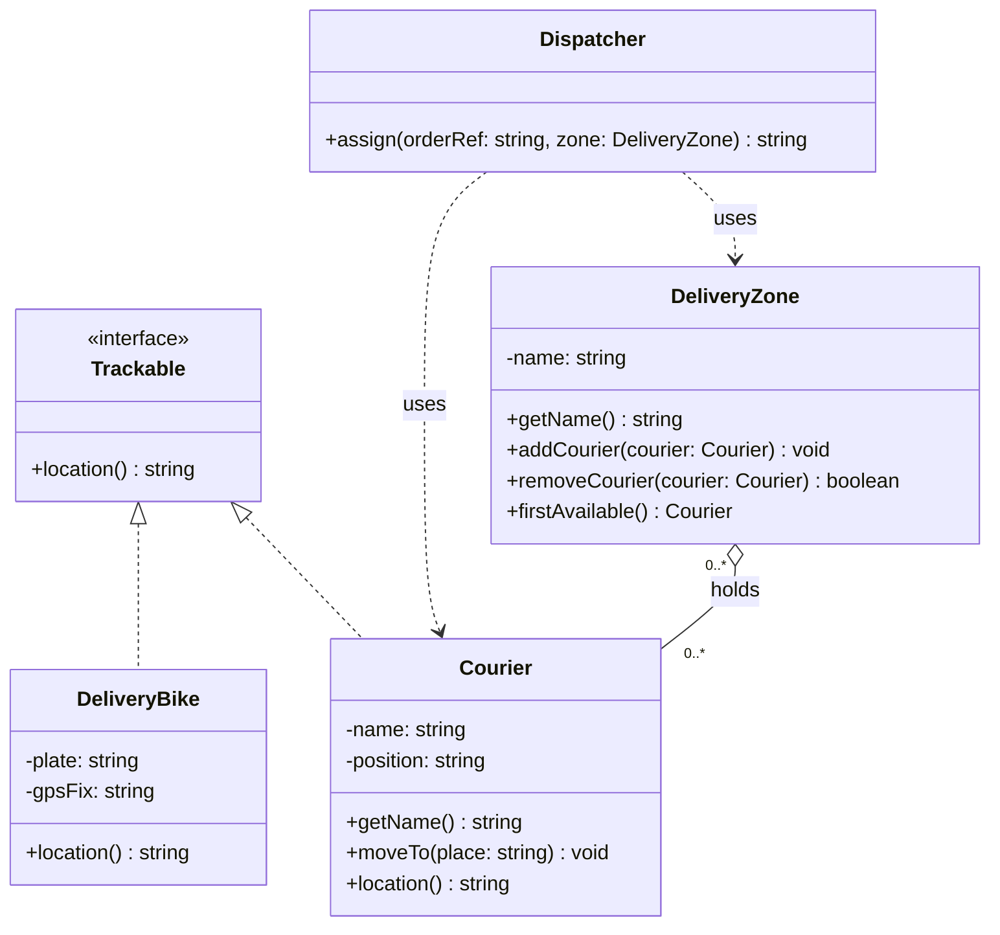

## Step 1

///////////////////////////////////////////////////

## Step 4

**Prediction 1.**

| Line | Will it be underlined in red? Which symbol in the diagrams of Steps 1 and 3 tells you? | The error message |
|---|---|---|
| (a) | Yes. `MenuItem` has `<<abstract>>` in its box, so we cannot create one directly | Cannot create an instance of an abstract class. |
| (b) | Yes. `category()` has `#` (protected) in the Step 3 diagram, so only the class and its subclasses can call it, not code outside | Property 'category' is protected and only accessible within class 'Dish' and its subclasses. |
| (c) | Yes. `-name` in the `Customer` box (Step 1) has `-`, so it is private | Property 'name' is private and only accessible within class 'Customer'. |

///////////////////////////////////////////////////

## Step 5

**Question 1.**

=> (a) Yes. `0..*` at the `Order` end: a customer can have zero orders
=> (b) No. `1` at the `Customer` end: an order has exactly one customer
=> (c) Yes. `0..*` at the `OrderLine` end: Bissap can be in many order lines
=> (d) No. `1` at the `MenuItem` end: a line refers to exactly one menu item

///////////////////////////////////////////////////

## Step 6

**Question 2.**

=> with only a list of `MenuItem`s there is nowhere to put the quantity. For 2 Thieboudienne we would have to write it twice in the list, and the order doesn't know "2" as one thing

///////////////////////////////////////////////////

## Step 7

**Question 3.**

=> `Order` owns its `OrderLine`s (it creates them and they only exist inside it), but an `OrderLine` doesn't own a `MenuItem`: the menu item exists on its own and many lines can use it

///////////////////////////////////////////////////

## Step 8

**Question 4.**

=> (a) No, the code is not wrong. The line between `Customer` and `Order` has no arrow, it only says they are linked. The link is kept on the `Order` side (the `customer` field), so `Customer` doesn't need an `orders` field
=> (b) The diagram is stricter than the code. The diagram says an order has at least 1 line, but the code lets an order start empty before `addLine` is called. One change: in the diagram, change `"1..*"` to `"0..*"` so it agrees with the code

///////////////////////////////////////////////////

## Step 10

**Prediction 2.**

=> `Moussa`
=> `undefined Moussa Médina`

**Question 5.**

=> the lines `plateau.removeCourier(moussa);` and `medina.addCourier(moussa);` show it. Moussa is removed from Plateau but still exists, and goes to Médina. With a filled diamond the courier would belong to one zone and disappear with it, so he could not move. Also Moussa is created before the zones, outside of them

///////////////////////////////////////////////////

## Step 11

**Question 6.**

=> `Dispatcher` would need to keep a `DeliveryZone` in a field (like `private zone: DeliveryZone`). Now it only receives the zone as a parameter in `assign()` and keeps nothing

///////////////////////////////////////////////////

## Part B diagram

## Step 12

**Question 7.**

| Relationship | Line number in `dispatch.ts` | That line of code |
|---|---|---|
| `Courier` realizes `Trackable` | 5 | `class Courier implements Trackable {` |
| `DeliveryBike` realizes `Trackable` | 27 | `class DeliveryBike implements Trackable {` |
| `DeliveryZone` aggregates `Courier` | 43 | `private couriers: Courier[] = [];` |
| `Dispatcher` depends on `DeliveryZone` | 70 | `assign(orderRef: string, zone: DeliveryZone): string \| undefined {` |
| `Dispatcher` depends on `Courier` | 71 | `const courier = zone.firstAvailable();` |
